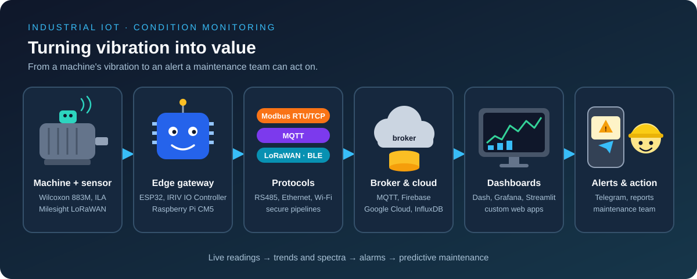
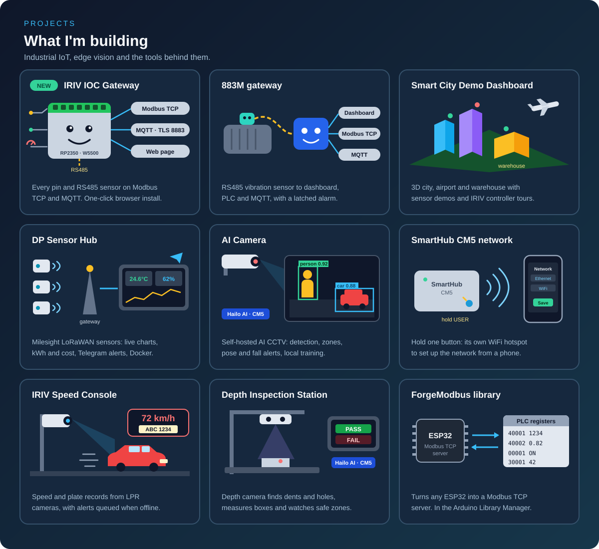
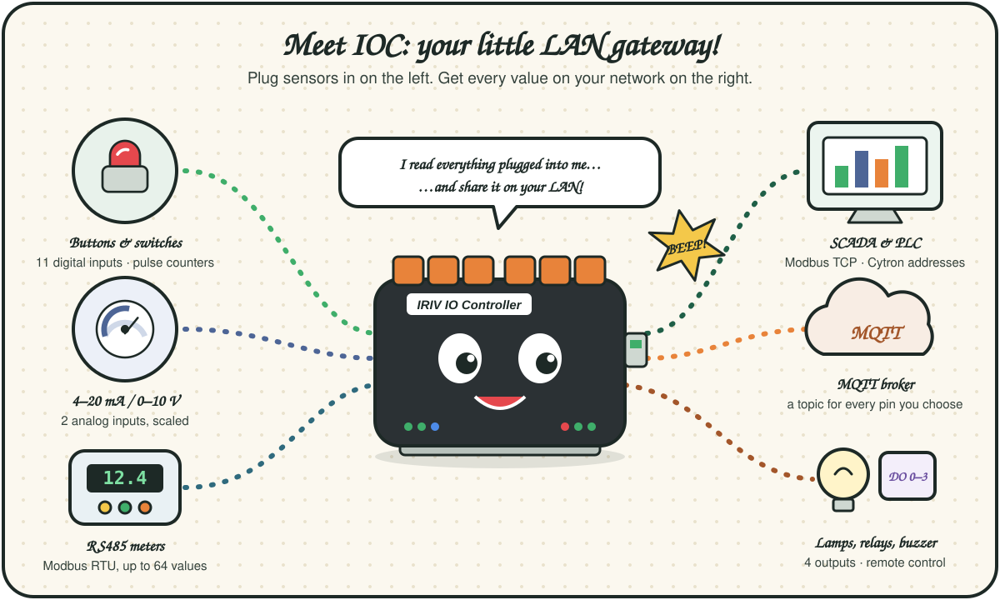
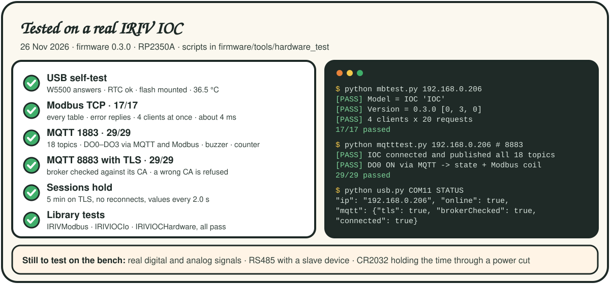
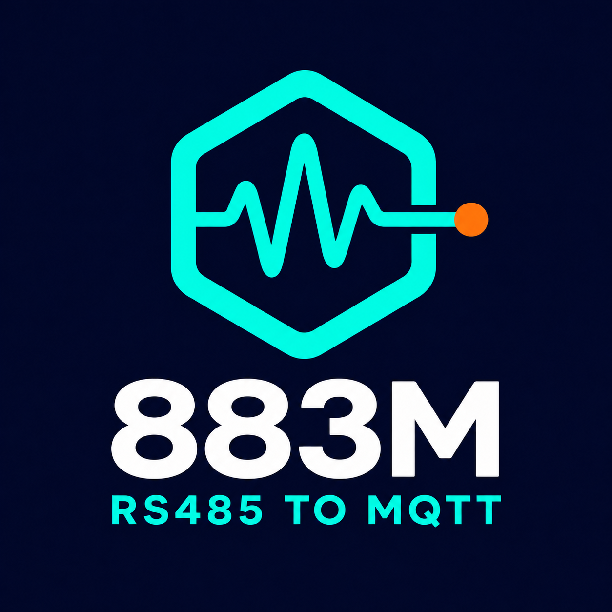
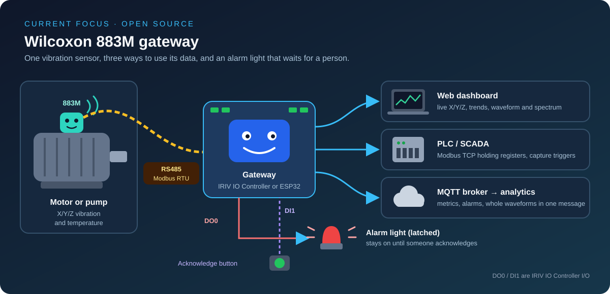
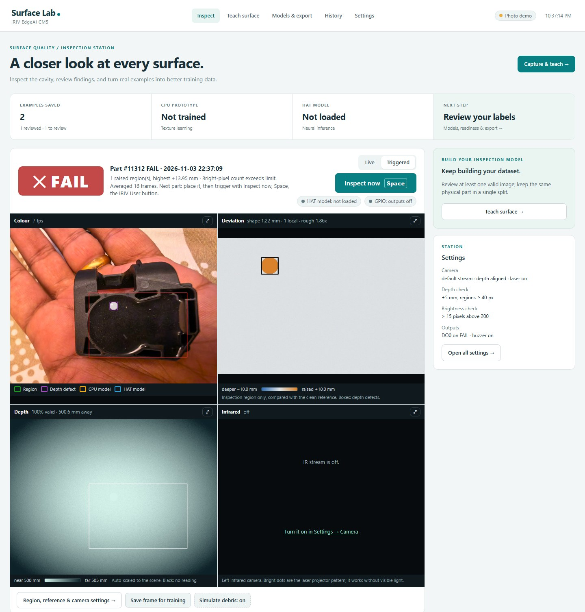

# 👋 Hi, I’m Dineshpal Singh

### 🔧 Industrial IoT Specialist | Condition Monitoring | Predictive Maintenance

I design and deploy end-to-end **Industrial IoT (IIoT)** systems specifically for monitoring rotating equipment. My work bridges the gap between raw sensor data and actionable maintenance insights, utilizing secure pipelines, real-time dashboards, and edge analytics.

> *"Turning vibration into value."*

---

### 🚀 What I'm Building Now

#### 🟢 IRIV IOC Gateway: new

Turns a **Cytron IRIV IO Controller** (RP2350A) into a LAN gateway: all 11 digital inputs, 4 outputs, 2 analog inputs, the buzzer and up to 64 **RS485 Modbus RTU** sensor values on **Modbus TCP** and **MQTT** at the same time.

- **One-click web installer:** plug in USB-C, click Install. It checks the hardware, installs the newest firmware from GitHub and shows the IP address. It updates older firmware straight away and asks before replacing other firmware.
- **The controller's own web page:** the full dashboard with live values at `http://<its IP>/`, Save to controller over the LAN, and updates from GitHub. Changes need a password.
- **MQTT over TLS on 8883**, with or without a CA certificate, plus plain 1883.
- **RS485 the easy way:** Test read a sensor first, then add it. It gets its own Modbus TCP address and MQTT topic automatically.
- **Our own libraries:** Modbus TCP/RTU, I/O and MQTT, no third-party Modbus or MQTT code.

Real input signals, RS485 with a real sensor and the backup battery are still to be tested on the bench.

[**Web installer**](https://dineshpalsingh1989.github.io/IRIV-IOC-Gateway/) | [**Source**](https://github.com/dineshpalsingh1989/IRIV-IOC-Gateway) | [**Wiki**](https://github.com/dineshpalsingh1989/IRIV-IOC-Gateway/wiki) | [**Project board**](https://github.com/users/dineshpalsingh1989/projects/4)

<!-- current-883m-project -->
#### 883M RS485 to MQTT

I’m working on the **Wilcoxon 883M gateway and its interactive learning experience**: sensor measurements over RS485/Modbus RTU, an IRIV IO Controller, MQTT data and a latched alarm workflow.

- **Gateway firmware:** 883M readings for browser dashboards, MQTT and Modbus TCP on supported boards.
- **Interactive walkthrough:** a narrated three-minute factory film with a motor/pump cutaway, sensor close-up labels, realistic cabling and a complete alarm event.
- **Hands-on learning:** clickable hardware, selectable wiring paths, synthetic fault comparisons and guided setup.
- **Documentation and design:** downloadable wiring guide, parts list, commissioning checklist, new project logo and improved mobile navigation.
- **Latest release (v4.13.0):** each whole waveform and spectrum now arrives as one MQTT message, so back ends no longer join pieces.

The walkthrough and example fault signals are simulated. The current custom IOC gateway reads one configured sensor ID; multi-sensor RS485 polling remains an expansion task requiring firmware changes and hardware validation.

[**Gateway source**](https://github.com/dineshpalsingh1989/Wilcoxon-883M_RTU-to-TCP-and-MQTT) | [**Explore the 883M demo**](https://dineshpalsingh1989.github.io/demodashboard/short-video-of-iriv-ioc-vibration/) | [**Wiring guide (PDF)**](https://dineshpalsingh1989.github.io/demodashboard/short-video-of-iriv-ioc-vibration/wiring-guide.pdf)

#### Smart City Demo Dashboard — interactive industrial showcases

I’m also improving the **Smart City Demo Dashboard**: a 3D city, airport and warehouse simulation with industrial sensor demonstrations, IRIV controller tours and interactive learning pages. The latest 883M experience is part of this project.

[**Live smart city**](https://dineshpalsingh1989.github.io/demodashboard/) | [**Dashboard source**](https://github.com/dineshpalsingh1989/demodashboard)
<!-- /current-883m-project -->

#### 📡 DP Sensor Hub v2.2 (Milesight LoRaWAN)

A self-hosted **MQTT broker and live dashboard for Milesight gateways and sensors**. Point the gateway at it and every sensor appears by itself: live values, charts, power and energy, Telegram alerts and remote commands. Data stays on your own server (DuckDB) or in the cloud (Firebase). One-command Docker install.

- **Telegram alerts:** leaks, low batteries, devices that stop reporting and readings outside your limits, plus a "back to normal" message.
- **Charts:** alert limit lines, 30-day history with hourly low-to-high bands, up to four lines compared, drag to zoom.
- **Energy:** kWh per day and cost from your tariff, live load and three-phase imbalance.
- **Weekly pattern** heatmap, rooms and search, and a full-screen **wall display**.

[**Live demo**](https://dineshpalsingh1989.github.io/gateway-dashboard/) | [**Source**](https://github.com/dineshpalsingh1989/gateway-dashboard) | [**Releases**](https://github.com/dineshpalsingh1989/gateway-dashboard/releases)

#### 📷 AI Camera

A self-hosted **AI CCTV dashboard** for Raspberry Pi 5 / CM5 with a **Hailo-8 / 8L** AI chip (runs on the Cytron IRIV EdgeAI CM5; falls back to CPU on any PC): live cameras, object detection and tracking, zones, line counting, pose and fall detection, face blur, heatmaps, alerts with photos and clips, Telegram, and quality inspection. Labelling and training run locally on the device.

[**Source**](https://github.com/dineshpalsingh1989/ai-camera)

#### 📶 SmartHub CM5 Network Dashboard

Set up the network of an **IRIV SmartHub CM5** with just a phone: hold the USER button, it starts its own WiFi hotspot, open a web page and choose Ethernet or WiFi settings. No keyboard, screen or app. Built to stay running: about 0.03 % of one CPU core when idle.

[**Source and download**](https://github.com/dineshpalsingh1989/smarthub-cm5-dashboard)

#### 🚦 IRIV Speed Console (Sensata AI Speed)
A local-first speed-enforcement dashboard for the **Cytron IRIV PiControl CM5** and **Milesight TS4466 / TS8266** LPR cameras.

* Live and historical speed/plate records with search, pagination and image evidence
* Telegram and email alerts with a persistent outbox, so no alert is lost when offline
* Workflow automation, analytics and hardware controls
* SQLite storage, single-file build, systemd service, CI with Bandit security scans
* Illustrated user manual and offline PowerPoint guide

*(Private repository, contact me for a demo.)*

#### 🔍 Depth Inspection Station (IRIV EdgeAI CM5 + Orbbec Gemini 336 + Hailo AI HAT+)
A 3D vision station that runs on the **Cytron IRIV EdgeAI CM5**. It uses an **Orbbec Gemini 336** depth camera and a **Hailo-8L AI HAT+**. One web dashboard runs three apps:

* **Surface inspection:** compares each part with a clean reference part to find dents, bumps, holes and dust, then gives PASS / FAIL. It can check every frame live or once per part on a trigger (dashboard, IRIV User button or DI0). A failed part switches on the DO0 reject output and a buzzer.
* **Logistics (boxes & bags):** measures length, width and height of items on a table with depth, and recognises bags with AI. It counts the items in view and the ones placed this session.
* **Safety & people:** warns when something enters a danger zone. A pose model on the AI HAT draws each person's skeleton, follows them with an ID and a movement trail, and shows their distance and walking speed.
* **Teach & train:** capture and label real examples in the browser, export a YOLO dataset with a Colab notebook, and compile it for the Hailo HAT.
* **Station tools:** a history of results with pictures, camera presets, and live CPU, temperature and RAM. It runs as a systemd service and has 100 unit tests.

*(Private repository, contact me for a demo.)*

#### 📈 Open-Source Vibration Monitoring Projects
| Project | What it does |
| :--- | :--- |
| [Wilcoxon-883M RTU to TCP and MQTT](https://github.com/dineshpalsingh1989/Wilcoxon-883M_RTU-to-TCP-and-MQTT) | ESP32 (C++) firmware bridging Wilcoxon 883M Modbus RTU sensors to Modbus TCP and MQTT |
| [Wilcoxon-ILA200-DashboardESP32](https://github.com/dineshpalsingh1989/Wilcoxon-ILA200-DashboardESP32) | ESP32 firmware with edge FFT analysis, Modbus TCP and MQTT for the Wilcoxon ILA200 |
| [Wilcoxon-VDS](https://github.com/dineshpalsingh1989/Wilcoxon-VDS) | Real-time vibration dashboard using Python Dash, MQTT, OPC and SQLite |
| [ILA210 and 883M Library](https://github.com/dineshpalsingh1989/ILA210-and-883M-Library) | Firmware downloads and Arduino/PlatformIO libraries for Wilcoxon sensor gateways on the IRIV IO Controller |
| [Wilcoxon883MRTU](https://github.com/dineshpalsingh1989/Wilcoxon883MRTU) | Arduino library: Wilcoxon 883M over RS485 Modbus RTU, with an optional Modbus TCP server for PLCs |
| [IRIV IOC Gateway](https://github.com/dineshpalsingh1989/IRIV-IOC-Gateway) | Every pin and RS485 sensor of the IRIV IO Controller on Modbus TCP and MQTT, with a one-click web installer |

---

### 👀 Focus Areas

* 🏭 **Machine Health:** Rotating equipment monitoring & diagnostics with  and   
* 📡 **Edge Hardware & Sensors:** , , , , , ,  

#### 🔌 ForgeModbus: Modbus TCP Library for ESP32
An Arduino library that turns any ESP32 into a Modbus TCP server over Wi-Fi or Ethernet. Available in the **Arduino Library Manager**.

* All four Modbus tables, with function codes 01–06, 15 and 16
* Read/write hooks, read-only ranges, and float helpers in all four word orders
* Settings saved to flash, IP allowlist, configurable timeouts and automatic network recovery
* Runs on ESP32, S2, S3, C3, C5, C6 and P4; CI builds every chip on each push

[**View project**](https://github.com/dineshpalsingh1989/ForgeModbus) | [**Examples**](https://github.com/dineshpalsingh1989/ForgeModbus/tree/main/examples)

---

### 🧰 Tech Stack Snapshot

| **Hardware & Edge** | **Protocols & Comms** | **Cloud & Backend** | **Visualization** |
| :--- | :--- | :--- | :--- |
|  **ESP32-C3** |  **Secure MQTT** |  **GCP** |  **Plotly Dash** |
|  **Ethernet** |  **Modbus** |  **HiveMQ** |  **Streamlit** |
|  **Vibration** |  **LoRa** |  **Node-RED** |  **Grafana** |

---
🌱 Currently Exploring

🛡️ Secure Edge & Broker Comms: Deploying TLS-secured MQTT streams between ESP32-C3 and mqtt.com.my, ensuring enterprise-grade encrypted telemetry for sensitive industrial environments.

📲 Remote Lifecycle Management (FOTA): Implementing Online Firmware-Over-The-Air updates for ESP32 nodes integrated with Wilcoxon 883M vibration sensors. This enables remote logic refinement and sensor recalibration without physical site access.

☁️ Google Cloud & Firebase IIoT:

⚡ Real-time Ingestion: Utilizing Firebase Realtime Database/Firestore for live streaming of high-frequency vibration data.

📦 Cloud Archival: Leveraging Google Cloud Storage for long-term vibration waveform and FFT data archiving.

⚙️ System Orchestration: Using Cloud Functions for automated processing, intelligent alerts, and seamless scaling from prototype to industrial production.

📊 Hybrid Dashboards & Automation:

Architecting unified views combining Firebase (Real-time) with SQL/InfluxDB (Historical Analytics).

Integrating Telegram Bots for instant threshold notifications and Automated PDF/Excel Reporting generated via Python backends.

🚦 Edge Vision: LPR cameras and speed-enforcement workflows (Cytron IRIV CM5, Milesight).

---

🌐 **Platforms:**  
  
**mqtt.com.my** – MQTT Broker & Industrial IIoT Messaging Platform  

🗄️ **Databases:**  

  

SQL (MySQL / PostgreSQL), InfluxDB, Firebase  

🚨 **Alerts & Automation:**  

  

Telegram Bot alerts, automated reports, threshold-based alarms

---
🔧 **Hardware:**  

  

ESP32 / ESP32-C3, **Raspberry Pi**, LoRa, BLE, Industrial Sensors  

📡 **Protocols & Communication:**  

  

MQTT, Modbus RTU/TCP, HTTP, BLE  

☁️ **Cloud & Tools:**  

  

Node-RED, Google Cloud, HiveMQ, InfluxDB  

📊 **Visualization & Dashboards:**  

  

Streamlit, Dash, Plotly  

🚨 **Alerts & Reporting:**  

  

Telegram Bot alerts, automated reporting

---
🌐 **Live IIoT Dashboards & Proof-of-Concepts**

🔧 **Industrial Monitoring Dashboard**  

  
🔗 http://176.97.117.59/

📊 **Real-Time Analytics & Visualization App**  

  
🔗 http://213.111.157.130:8050/  or 213.111.157.130

---
### 🤝 Open to Collaboration

I am actively looking to collaborate on projects involving:
* **Predictive Maintenance Algorithms** (FFT analysis, anomaly detection).
* **Smart Industrial Sensors** (Custom PCB design or firmware).
* **Scalable IIoT Architectures** (From sensor to cloud dashboard).

> *"Turning vibration into value."*

[**📫 Let’s connect & build reliable industrial systems!**](https://github.com/dineshpalsingh1989)

